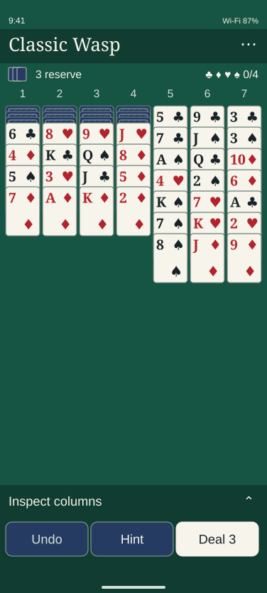
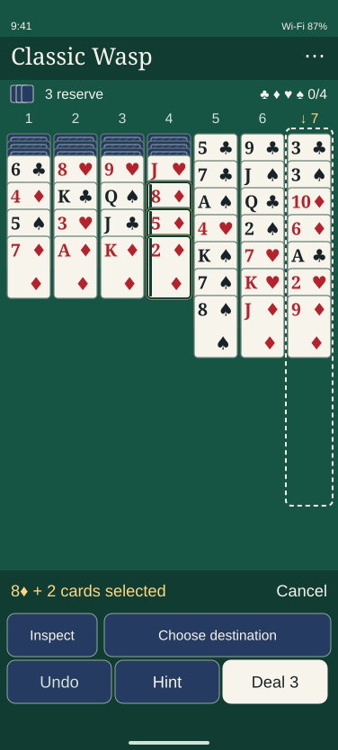
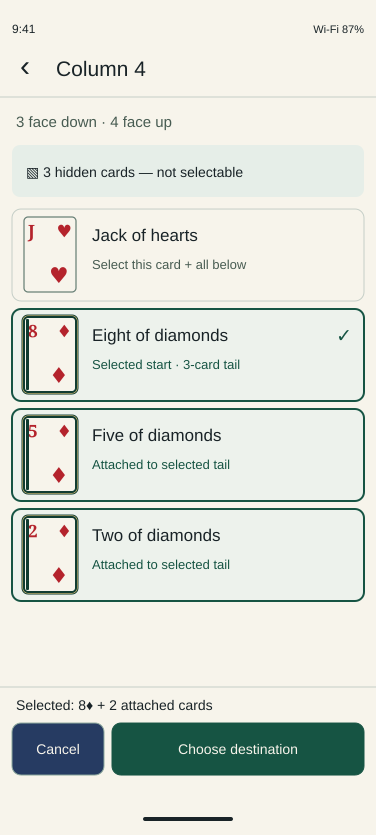
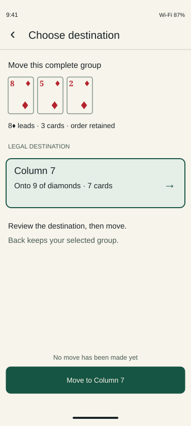
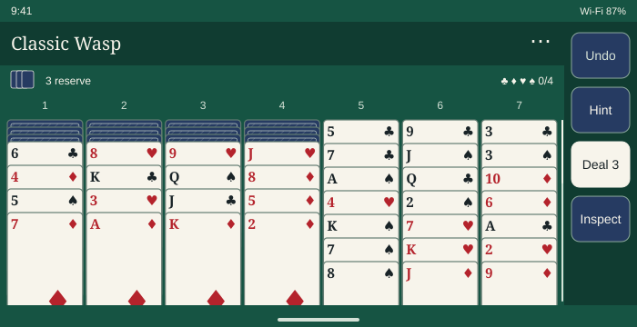
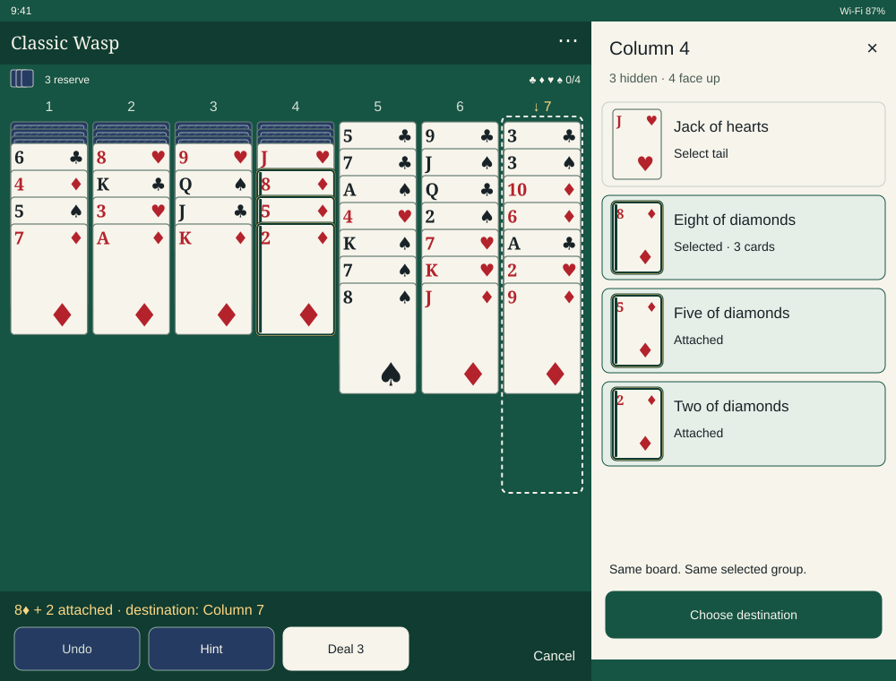
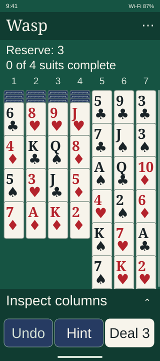
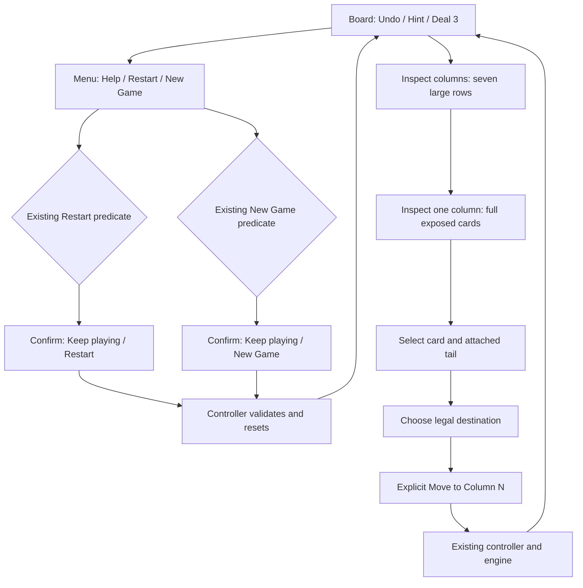
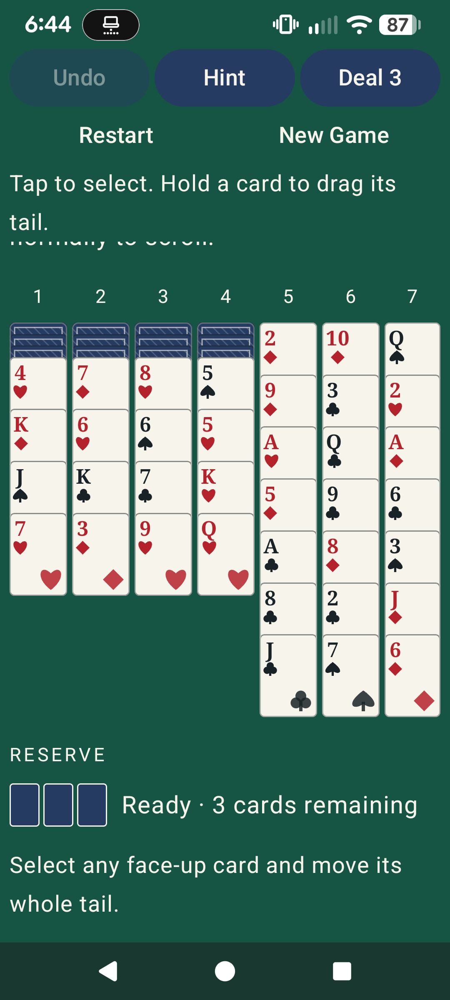

# Phase 4D: Modern classic interface — design review

**UNAPPROVED PROPOSAL · Stages 1–3 only · 2026-10-31**
Tracking: [Issue #15](https://github.com/FoxyLight/Wasp-Solitaire/issues/15). Application implementation, acceptance and merge are separate owner gates. This package changes documentation only. No design decision below is recorded as accepted.

## Recommendation and executive summary

Adopt Option B: modernize the classic table. Keep deep green felt, ivory faces, blue backs, traditional red/black suits and all seven columns. Replace the permanent teaching block and two control rows with a compact header, reserve/run summary and a bottom play dock. Put full-card inspection and an explicit legal destination chooser alongside direct tap and drag play.

The main problem is allocation of usable space and access to crowded cards, not missing decoration. The physical Pixel 7a shows instructions clipped at the pinned controls and selection feedback boundary. The implementation lacks expanded inspection, so a tiny exposed strip still has no reliable large-target alternative. Short landscape currently solves space pressure by shrinking cards. The proposed alternative keeps readable cards, scrolls the board and moves actions into a side rail.

No rules conflict was found. These are refinements of accepted UX-DEC-01–07, especially inspection and non-drag access in UX-DEC-03/04/06. Completed runs remain in place. Progress symbols are indicators, **not foundations**. Timer, statistics, Settings, Save and durable resume are absent until their approved milestones.

Review [the visual gallery](gallery.html) in a browser or the individual illustrations below. The gallery is a documentation preview, not a playable app or an accessibility implementation. [Acceptance and risk matrix](validation.md) specifies the work still required after approval.

## Verified baseline and evidence limits

- Fetched current `main`: **6c64b6a4899bb3e0fa7790ff1422470608810b83**. [PR #18](https://github.com/FoxyLight/Wasp-Solitaire/pull/18), [#19](https://github.com/FoxyLight/Wasp-Solitaire/pull/19) and [#20](https://github.com/FoxyLight/Wasp-Solitaire/pull/20) are merged; Issue #14 is closed; #15 is open. Earlier wording describing #20 as proposed is historical, not current status.
- Main's [CI run 41249055970](https://github.com/FoxyLight/Wasp-Solitaire/actions/runs/41249055970) passed both required `verify` and `emulator` jobs. Its downloaded emulator report records 17 tests with no failures. The Phase 4C report records 41 JVM tests and 13 focused physical-device tests at the unchanged application/test code head `7f9e88237583d0ef90d1e6827d9079dc9ea14762`. Application and engine sources at that head and current main have no diff. These are baseline results, **not redesign test passes**.
- Reviewed rules, product requirements, architecture, UX, decisions, roadmap, Phase 4 delivery plan, Phase 4B board report, Phase 4C gameplay report and Issue #15; inspected GameBoard, geometry, drag, controller/ViewModel/repository, tests and assets. The existing card artwork is Compose-rendered typography and geometry; no new external card pack was imported.
- Visually reviewed all five committed [Phase 4C evidence images](../../evidence/phase4c/), including large text, short landscape, whole-tail drag, confirmation and victory. Downloaded current-main CI rendering evidence and reports; read-only board fixtures are not represented as full application screens.
- On the owner's unlocked **Pixel 7a**, inspected the installed app and selected a face-up card, then canceled with Back. No move, reserve deal or reset was committed. Installed APK SHA-256 `fcbee71a58a78f0197e6d35bacf08bfe88cdda7704dd97bc6556a83b86ad8966` matches the CI-built Phase 4C APK whose sources match main. Device: Android 17/API 37, 1080×2400px, configured density 460, font scale 1.3. Display settings were read, not changed.
- The two new Pixel captures are actual application screenshots. Only own-app semantics were retained in [visible-semantics.json](evidence/visible-semantics.json); no device identifier is needed in the package. They show a globally scrolled viewport and a random deal. Mockups use a different, reproducible deal. They are not same-seed pixel comparisons or measured task-time improvements.
- TalkBack speech, switch access, contrast on an implemented redesign, 200% physical-device behavior and new adaptive interactions have **not** been tested. There is no new Android build in this design stage.

## Audit: strengths, problems and evidence

Strengths to retain: identifiable traditional suits and faces; all seven columns; whole-tail drag preview; explicit tap/destination flow; legal target outlines; reserve remains available with legal moves; meaningful destructive confirmations; retained completed runs and victory Undo. Engine legality and serialized immutable state provide a sound foundation for an inspection view.

Classification: **Confirmed** means directly observed or absent/present in code; **Risk** means likely usability trouble requiring hands-on validation; **Preference** means a design choice rather than a correctness defect. P1 blocks the intended accessible/everyday experience; P2 improves clarity and consistency.

| Priority / type | Finding and specific evidence | Proposed response |
| --- | --- | --- |
| P1 Confirmed gap | No expanded column view or explicit accessible destination list exists in `GameBoard.kt`. Closely overlapped cards remain direct small-strip targets. | Full-height card inspection and 48dp+ destination rows; every legal source/tail reachable without dragging. |
| P1 Confirmed usability defect | Actual Pixel captures show a partial instruction line cut at the pinned feedback boundary. GameBoard lines 107–139 place controls/feedback above a globally scrolling title, objective and **120dp × fontScale** instruction block. Permanent instructions displace the tableau. | Compact header/status; remove permanent teaching block; contextual feedback and help in Menu; board scrolls independently of persistent controls. |
| P1 Risk, code supported | `BoardGeometry.fit` limits width by available height, with a 20dp minimum and rank size `width × .27`; the theoretical minimum rank is 5.4sp. Short-landscape evidence shows strong size reduction. Passing reachability assertions do not establish legibility. | Width-driven readable card size; vertical board scrolling; action rail in short landscape; inspection fallback. Never reduce rank size to make a whole column fit. |
| P1 Confirmed semantic gap | Card descriptions and face-state strings exist (GameBoard lines 254–261), but no attached-tail count, native selected semantics, inspection actions or explicit legal destination actions. Current visible hierarchy also contains child rank/suit nodes. | Deliberate column-summary focus groups, separate full-card rows, selected/start/attached announcements and custom actions. Duplicate speech is a risk until TalkBack is heard. |
| P2 Confirmed organization issue | Reserve/status is below the full tableau (GameBoard reserve component); Restart and New Game occupy a second top row outside short landscape. Permanent rule text repeats around the board. | Compact reserve/run status above board; Undo/Hint/Deal 3 always reachable; all secondary actions consistently in Menu. |
| P2 Confirmed contrast shortfall | Gold-on-ivory selection boundary is weak; proposed palette calculation is only 1.25:1. Existing selected-tail screenshot illustrates this edge. | Dark 2dp inner boundary, gold outer accent, leading bar and text/check state. Gold is never the only selected cue. |
| P2 Confirmed placement / risk | Drag notice is bottom-aligned outside the safe-drawing column (GameBoard around line 164); committed drag image places feedback in the light navigation scrim area. | Keep lift/status/feedback inside safe insets and above dock/rail. Test both gesture and three-button navigation. |
| P2 Risk | Long selected groups, distant destinations and very small overview strips complicate direct hit targeting. Drag has no edge auto-scroll. | Stable source anchor, whole-tail preview and broad visible column drop zones; inspection/chooser is an equally complete route. Auto-scroll deferred unless independently reliable. |
| P2 Preference | Default modal styling and generic Confirm action differ from the table's visual hierarchy. Victory repeats teaching/status text. | Ivory native modal with explicit Restart/New Game label; concise victory summary preserving board and Undo. No statistics/timer placeholders. |

The evidence distinguishes wasted chrome from legitimate empty table. Green space below a short initial column is intentional room for later play, not a reason to enlarge decorative headers. The redesign removes repeated instructions while reserving growth space for real tails.

## Proposed decisions for owner approval

| ID | Proposed decision and practical consequence | Existing requirement refined |
| --- | --- | --- |
| **4D-UX-01** | Board-first screen. Only the board scrolls during normal play; readable ranks take precedence over fitting all cards vertically. | UX-DEC-01/03 |
| **4D-UX-02** | 48dp compact header/Menu, compact reserve/four-suit progress, persistent Undo/Hint/Deal 3 dock or rail. Restart/New Game in Menu, contextual help rather than permanent instructions. | UX-DEC-05 |
| **4D-UX-03** | Inspect columns entry opens seven large column-choice rows, then full-card inspection of any exposed card. Selecting a row selects that card and its entire tail. Preserve selection on return. | UX-DEC-03/04 |
| **4D-UX-04** | Selected group offers Inspect and Choose destination. Chooser lists engine-derived legal columns; choose a row, then explicit Move to Column N. Direct board tap-to-move remains available. | UX-DEC-04/06 |
| **4D-UX-05** | Width-driven card geometry, traditional indices, controlled overlap, dark selected edge plus accent, labeled/dashed legal targets and a distinct Hint label. | UX-DEC-02/04 |
| **4D-UX-06** | Explicit portrait dock, short-landscape rail, tablet inspection pane and large-text reflow; no height-driven tiny card fonts. | UX-DEC-03 |
| **4D-UX-07** | Full non-drag gameplay, logical focus groups, rank/suit/column/face/tail semantics, selected and legal actions, deliberate return focus and announcements. | UX-DEC-06 |
| **4D-UX-08** | Contrast-checked colors, scalable text, safe insets, no color-only state and reduced-motion behavior using system preferences. | UX-DEC-01/06/07 |

All eight are **PROPOSED**. No new game rule, state owner, storage contract or Version 1.0 feature is requested. If implementation reveals a conflict with approved requirements, bring that specific conflict to the owner before changing behavior.

## Portrait board and selection

376×835dp reference, approximating the owner's configured Pixel width; 41dp top and 48dp bottom inset bands are illustrative, not hard-coded device constants. Header 48dp, summary 32dp, column labels 24–28dp. Normal dock: 48dp inspection/context row and 56dp play row, plus actual bottom inset. The first card is around 149dp from the top of this illustration, without the old teaching block. This is a design geometry target, not a measured implemented improvement.

Reserve shows three backs and count; spent reserve reads Dealt and Deal 3 is disabled. Four suit symbols carry completion state and `n/4`; completed runs stay in their actual columns. Empty columns use a bounded slot with column number and Empty label. Menu and inspection controls have distinct 48dp+ hit areas; narrow column headings do not pretend to be seven adjacent 48dp targets.

The fixture is exported from the actual Kotlin engine for seed 123 ([data](deal-seed-123.json)). Column 4's 8♦ carries 5♦ and 2♦ in their existing order. The engine enumerates Column 7's 9♦ as legal. All seven columns, 49 tableau cards, 12 hidden cards and three reserve cards are represented. Hidden card identities are never drawn or announced. No solitaire stock/waste/foundation arrangement is substituted.

Selected tails get an outer warm accent, dark inner boundary and start marker; destination columns get a dashed edge, arrow and column number. The selected context names the lead and attached count. Its two actions are Inspect selected column and Choose destination, plus a separate 48dp Cancel target; use two context rows rather than squeeze three targets. This expands the context area from 48 to 96dp while selected. Selecting a different source makes no move. Tap a legal board column to commit through the existing controller; tapping a nonlegal destination announces failure and retains the group.

Hint gets a labeled source/target marker rather than changing selection silently. Reserve fallback remains available. Successful move feedback names source, destination and card count. Invalid drop returns the overlay, preserves selection and state/history, and explains the rejection. A canceled drag does not cancel an explicit source selection unless Cancel/Back is invoked. Drag carries the complete tail, with readable lead/count and an offset preview that does not hide the target; long tails may extend within a clipped preview, but never disappear from the announced card count or engine intent. No extra rules are inferred by the overlay.

## Full-card inspection and destination selection

Inspect columns opens a list of seven 48dp+ rows (column number, hidden/exposed count and top exposed card). This makes every column reachable at 320dp without overlapping enlarged hit boxes. Opening a column does not change game selection. The inspection surface presents hidden cards as a count only and every exposed card as its own full-face row in actual top-to-bottom order. Default row minimum 96dp with a roughly 52×75dp complete card and full rank/suit text; row heights grow and content scrolls for large text. Any exposed card can be the start; no ordered-tail precondition is added. Selected start and attached rows are visually and semantically distinct.

Choose destination lists **only engine-derived legal destinations**, naming column and exposed destination card, or Empty column. Choose a row, then press Move to Column N. One legal destination is still explicit; never auto-commit it. If there are none, show No legal destinations for this group with Back, Cancel and return-to-board/Hint access. Do not report defeat or recommend a fabricated solver move.

### State, cancellation and lifecycle contract

The inspector observes the same immutable GameUiState as the board and dispatches through the existing GameViewModel/controller. There is no copied tableau, second rules engine or inspector-only move implementation. Route, viewed column and scroll anchor are ephemeral presentation state; game selection remains authoritative. Use stable card identity plus expected revision/source indices when submitting a move; existing controller/engine validates at commit.

| Event | Required behavior |
| --- | --- |
| Back from chooser | Return to inspection or board origin; keep selected group; no write. |
| Back from inspection / close tablet pane | Return to board; keep selected group; restore focus to originating column/card control. |
| Cancel selection | Clear group and destination; stay on current inspection/board route; no game/history mutation. Back on selected board cancels selection before leaving gameplay. |
| Very long column | Independently scroll full-card list; keep header and selection/destination footer reachable; never compress rows to fit. Preserve scroll anchor by card identity. |
| Game revision changes while open | Re-derive visible cards/destinations. Clear an invalid source or chosen destination, announce Board changed; choose again. Retain a still-valid source only after controller reconciliation. Never submit stale indices against new state. |
| Accepted move | Close chooser/phone inspector, focus destination column summary, announce moved count/source/destination and uncovered face if any. Tablet pane follows destination or remains clearly labeled; no stale source selection. |
| Rejected write/invalid move | No game, revision or Undo mutation. Keep valid selection and view; announce reason; allow retry/cancel. |
| Undo / reserve from board | Existing serialized intent behavior; refresh derived inspection and reconcile selection. Never maintain separate inspector history. |
| Restart / New Game | Preserve existing confirmation predicates. Cancel retains route/selection; successful reset closes overlays and clears presentation anchors. Failed confirmed reset remains retryable. |
| Rotation / window resize | Retain presentation route, selected group and anchored card through the existing ViewModel lifetime; adapt sheet/pane without executing an action. Interrupted drag cancels visually. |
| Process termination | Current in-memory session limitation remains. No durable restoration, Save, autosave or process-death promise. |

## Adaptive specification

| Available window | Arrangement and geometry | Overflow / inspection |
| --- | --- | --- |
| Narrow portrait ~320dp | 8dp margins, 4dp gutters, seven ~40dp cards. Header/menu 48dp; normal 14sp minimum indices. Compact text/count summary. Persistent dock. | Board scrolls; column list and full-card inspection provide 48dp+ routes; do not inflate seven touching headings into overlapping targets. |
| Portrait 360–400dp | ~46–51dp card width; 1:1.44 faces; 15sp rank/suit headers, 26dp exposed step at 100%, ~30dp at 130%; 8dp hidden step. | Default board dominant; long columns scroll inside board; dock remains above system navigation. |
| Short landscape, e.g. 700×360dp | Header/status on board region; ~80dp right rail containing four 48dp+ actions. Remove the bottom horizontal dock. Width-driven cards; no height-driven font collapse. | Shared board scroll; full-screen inspection. If text needs more rail width, expand it or switch to wrapped action rows while preserving 48dp targets. |
| Large window ≥800dp, sufficient height | Board and ~320dp inspection pane when open; minimum board width ~448dp before using pane. Max card width ~96–104dp. Center board when pane closed. | At 800dp use pane only if board width and readable cards remain viable; otherwise use modal inspection. Pane has its own scrolling/footer. |
| Resizable / height <480dp | Choose arrangement from **available dp**, actual text measurements and insets, not device name or orientation alone. Rail for short windows; sheet if side pane does not fit. | Preserve route/selection while moving between arrangements. Both axes and cutouts must remain safe; no system-settings changes. |
| 320dp / 200% text | Short Wasp title, stacked reserve/progress rows, 14sp base indices → ~28sp; stack suit beneath rank, exposed step ~66dp and card height at least 74dp. 56dp inspection entry and 64dp action row minimum, grow for wrapped labels. | Board may require substantial vertical scroll. Inspection rows grow to fit full text; full legal gameplay stays reachable without targeting strips. Never truncate essential labels or counteract system font scale. |

The clipped lower card region represents scrollable board content, not missing cards. Implementation needs a visible scroll affordance when content exceeds the viewport; selection/chooser can reach every move without drag auto-scroll.

## Navigation and confirmation flow

Help explains current rules and controls only. Existing Reset confirmation conditions stay authoritative: Restart only when actions/history would be discarded; New Game confirms during in-progress play, including an untouched deal; post-victory behavior stays as implemented. Cancel/Back makes no reset; explicit destructive label replaces generic Confirm. No fake Statistics, Settings, Save or timer controls. Victory is a concise announcement/banner over the retained board, with Undo and New Game; no new statistics or elapsed-time claims.

## Accessibility interaction flow and semantics

1. Initial focus order: game identity/Menu, reserve and run summary, columns 1–7 in visual order, context/inspection, Undo/Hint/Deal 3. The board exposes a deliberate column summary per column rather than all rank text plus redundant overlapping child nodes. A column announces e.g. “Column 4, seven cards, three face down, four face up, exposed two of diamonds. Inspect column.”
2. Activate Inspect column or the always-present Inspect columns entry. Modal focus enters its titled surface and stays inside until Back/close. Hidden aggregate is descriptive and never selectable; no hidden rank or suit is exposed. Each full-card row is one native actionable semantic node; decorative symbols merge into it.
3. Example source: “Eight of diamonds, face up, Column 4, card 5 of 7, three-card tail including two attached cards. Select tail.” After activation: “Selected start, eight of diamonds with two attached cards.” Five and two announce Attached to selected tail, not Selected start. Add custom Choose destination and Cancel selection actions where appropriate; also provide visible buttons so custom actions are not the only path.
4. Destination rows announce column, top card or empty state, and legal status. Chosen row has selected semantics; Move to Column 7 names the action before execution. Announce move success once and focus destination column summary. Rejected actions announce a concise error and preserve state.
5. Tab/Shift+Tab traverses native actionable controls; Enter/Space activates; Escape/Back reverses one navigation level. No keyboard trap. Switch-style scanning follows the same large-row route where supported. Exact TalkBack action names, heading order and focus restoration must be verified on Android, not inferred from this HTML gallery.

Use native selected/disabled/state semantics and traversal groups. Avoid duplicate live feedback: polite announcements for committed actions and selection; errors/confirmations announced clearly; never announce every drag frame or redraw. Standalone buttons and list rows target at least **48×48dp**, with no overlapping invisible expansion. Overview strips may remain smaller only because inspection offers the complete alternative.

## Components, type, spacing, colors and motion

- Grid uses 8dp phone margins and 4dp inter-column gap, 4/8/12/16dp spacing rhythm. Cards retain 1:1.44 default ratio and ~4dp radius. Inspector rows use 12dp surface margins and 12–16dp internal spacing; scrolling content must clear the fixed footer.
- Traditional rank/suit artwork: retain original programmatic geometry; use platform/system typography without importing an unlicensed pack. Serif rank index, sans-serif controls. Card ranks 14–15sp minimum on phones, up to ~22sp on larger cards; control/body text 14–16sp; inspection title ~20sp, card name ~17sp, supporting text ≥13–14sp. Honor system scale, wrapping and nonlinear font metrics; inspect all ten/queen/king labels. Do not set fixed text containers that clip at 200%.
- Base colors: table `#165443`, ivory `#F7F4EB`, backs/buttons `#263B62`, red `#B4232C`, black `#192327`, deep edge/chrome `#103C31`, accent `#FFD782`, secondary table text `#D4E1D6`. Back weave is restrained and original. No photo texture, imported card pack, decorative dashboard or new theme setting.
- [Nominal sRGB calculations](contrast-calculations.json): black/ivory **14.56:1**, red/ivory **5.93:1**, ivory/green **8.01:1**, secondary/green **6.52:1**, ivory/blue **10.13:1**, deep selected edge/ivory **11.15:1**. Gold/ivory is **1.25:1**, so gold is supplementary only. Validate final rendered text, focus, edges and disabled states; these calculations are not an accessibility certification.
- Use at least 4.5:1 for normal text and 3:1 for meaningful non-text boundaries/large text where applicable. References: [Android accessibility guidance](https://developer.android.com/guide/topics/ui/accessibility/apps), [Compose accessibility defaults](https://developer.android.com/develop/ui/compose/accessibility/api-defaults), [WCAG 2.2 contrast](https://www.w3.org/WAI/WCAG22/Understanding/contrast-minimum.html) and [non-text contrast](https://www.w3.org/WAI/WCAG22/Understanding/non-text-contrast.html).
- Restrained lift/snap only; respect system animation/reduced-motion preferences and avoid delayed interactions or celebratory motion that obscures cards. No new sound, haptic or appearance settings in 4D. Meaning and success remain available with all animation disabled.

## Before / proposed after

| Actual Phase 4C evidence | Proposed equivalent | What can be assessed |
| --- | --- | --- |
| [Pixel portrait](evidence/before-pixel-portrait.png) and [selection](evidence/before-pixel-selected.png) | [Portrait](mockups/portrait.svg), [selected group](mockups/selected-tail.svg) | Space allocation, permanent controls, removal of clipped teaching block. Different deals and view positions; no speed or same-card size result claimed. |
| [Whole-tail drag](../../evidence/phase4c/drag-whole-tail.png) | Selected-tail board and inset-safe feedback spec | Preserve whole unordered group, improve selection boundary and feedback placement. No new drag test has run. |
| [Short landscape](../../evidence/phase4c/interactive-landscape.png) | [Side-rail landscape](mockups/short-landscape.svg) | Alternative layout versus shrinking cards; scrolling needed for long columns. |
| [200% text](../../evidence/phase4c/interactive-large-text.png) | [Large text](mockups/large-text.svg), growing inspection rows | Readability and route to every card, not a claim that all 49 cards fit without scrolling. |
| [Restart confirmation](../../evidence/phase4c/restart-confirmation.png), [victory](../../evidence/phase4c/victory-runs-retained.png) | Explicit action labels / concise retained-board victory flow above | Preserve safety predicates, full runs and Undo; no fabricated timer or statistics. |

## Implementation boundary and approval request

After explicit design approval, branch from then-current main. Keep engine, GameController, ViewModel/StateFlow, repository contract and immutable game state. Presentation state and accessible routes must use the same serialized intents. Proposed review slices if needed: (A) board chrome, geometry, insets and adaptive controls; (B) full inspection, destination chooser, semantics/focus and complete device validation. Each slice must remain usable and independently tested; no weakening tests, engine invariants or protection. The final implementation PR must pass both required CI jobs on its exact head and remain open for separate merge approval.

Room, process-death recovery, DataStore settings, timer, statistics, variants, solver, accounts/sync/monetization, signing and publication remain excluded. Current session/Undo is in memory. Issue #15 stays open until accepted implementation is merged.

**Owner decision requested:** approve or revise 4D-UX-01 through 4D-UX-08 and the portrait, selection, inspection/chooser, landscape, tablet and 200% text arrangements. Stages 1–3 stop here. No application implementation begins automatically, and approving this documentation PR is not merge approval for future application code.
