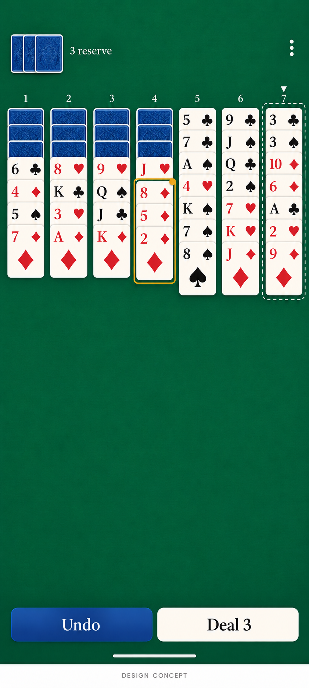

# Phase 4D: approved modern classic interface

Owner explicitly approved the final design in the Work conversation on **2026-11-01**. This authorizes Phase 4D implementation, not merge or publication. Refs [Issue #15](https://github.com/FoxyLight/Wasp-Solitaire/issues/15). The implementation branch starts from main `6c64b6a4899bb3e0fa7790ff1422470608810b83` (merged PR #20, closed Issue #14). The earlier [proposal PR #21](https://github.com/FoxyLight/Wasp-Solitaire/pull/21) is an unmerged historical proposal; its inspection/Hint/title/progress layouts were revised during owner review and are not the approved design.

## Approval record and scope changes

| Decision | Approved final behavior |
| --- | --- |
| 4D-UX-01 | Board-first green table; remove permanent title, tagline and teaching block. Seven columns remain visible across the width; long tails scroll together. |
| 4D-UX-02 | Compact reserve/menu row. Exactly two persistent play controls: Undo and Deal 3. Restart, New Game and Help in Menu; destructive confirmations retained. |
| 4D-UX-03 | **Revised by owner:** remove the separate Inspect screen and button. Readable exposed strips, board scrolling and direct accessibility actions replace inspection. |
| 4D-UX-04 | Tap a face-up card selects that card and its whole attached tail. Tap legal column commits that group. Tap illegal column clears selection only: board, revision and Undo stay unchanged. No separate visible destination chooser or selection toolbar. |
| 4D-UX-05 | Warm ivory faces, original traditional suit artwork, restrained blue backs, continuous gold/dark selected-group outline; legal columns have arrow plus dashed edge. Completed suits stay on the board; no top completion display. |
| 4D-UX-06 | Portrait bottom controls, short-window side controls, centered width-capped tablet cards. Large text stacks indices and grows overlap; no height-driven tiny type. |
| 4D-UX-07 | Every exposed source and legal destination available through board accessibility actions, native selected/start/attached-tail semantics and keyboard controls. No second tableau or rule implementation. |
| 4D-UX-08 | High-contrast palette, safe insets, non-color state cues and immediate feedback without required motion. No new preference settings. |

The owner explicitly removed **Hint as a feature**, including reserve suggestions. This supersedes MVP-08 / MVP-DEC-03 and the Hint portions of UX-DEC-05 and MVP-12. The pure engine's existing legal-move/hint APIs and tests remain unchanged to preserve its established contract; the application exposes no Hint intent, state or control. RULE-01–06 and all engine legality remain unchanged.

The image is an AI-generated design illustration, not an application screenshot or imported runtime card pack. It is the owner's accepted visual direction; platform typography, responsive spacing and actual rendered evidence are validated separately. The concept has no title, Hint, Inspect, completion display or extra selection toolbar.

## Implementation contract

The existing GameController, ViewModel/StateFlow, immutable GameSession and atomic repository contract remain authoritative. Invalid tap destinations are validated by the engine before clearing transient selection; failed writes and stale revisions do not fabricate successful moves. Direct explicit `Select` remains available to accessibility and drag inputs; the visual two-tap path always treats its second card/column tap as a destination, including the source column. Back cancels selection. Whole-tail long-press drag remains supported; no auto-scroll dependency is introduced.

Cards use original Compose suit paths, not the generated image artwork. Width determines card size (maximum 104dp), ranks never shrink below a 14sp base to fit height, and exposed overlap grows for system text scale. All seven columns share a scroll surface. Empty columns remain visible destinations. Large standalone menu/play controls target at least 48dp; narrow overview strips are not falsely described as 48dp targets.

Each column exposes native custom accessibility actions for every exposed card, naming rank/suit and attached count. After selection, legal columns expose an explicit Move action, with Cancel selection also available. Card semantics distinguish selected start from attached cards and never reveal hidden identities. Keyboard: Tab to a column, Up/Down chooses an exposed source, Enter/Space selects or commits to the focused column, Escape cancels. A focus cursor scrolls into view. These are direct board actions, not a replacement Inspect screen. TalkBack listening and Switch Access must be reported only when actually exercised.

Normal selection, illegal-tap cancellation and success feedback have a polite live region without a visible selection toolbar. Storage errors, stale-state notices and victory are readable visible feedback. Confirmations retain existing reset predicates and use explicit Restart / New Game action labels.

## Validation record (in progress)

- Required `verify` and `emulator` jobs must pass on the final implementation PR head; links, actual counts and reviewed screenshots will be recorded before handoff.
- Existing engine invariants, tap/drag equivalence, reserve/Undo, confirmations, lifecycle and rejected-write tests are preserved. Obsolete Hint/inspection expectations are replaced with owner-approved behavior checks, not suppressed tests.
- Additional checks cover all illegal tap destinations over seeded deals, direct custom accessibility actions for every legal seeded source/destination, attached-tail semantics, keyboard selection/move, narrow/landscape/tablet/200% layouts and real Activity recreation/rotation.
- Pixel 7a is connected via the existing wireless development access. No new physical test pass is claimed yet.

## Scope boundaries

Session and Undo remain in memory; process termination still loses the game. Room saves, process-death recovery, DataStore, timer/statistics, variants/solvers, accounts/sync/monetization, production signing and publication are deferred. No branch protection, required CI or game-rule relaxation is permitted. Keep the implementation PR open for separate owner merge approval; close Issue #15 only after accepted implementation is merged.
