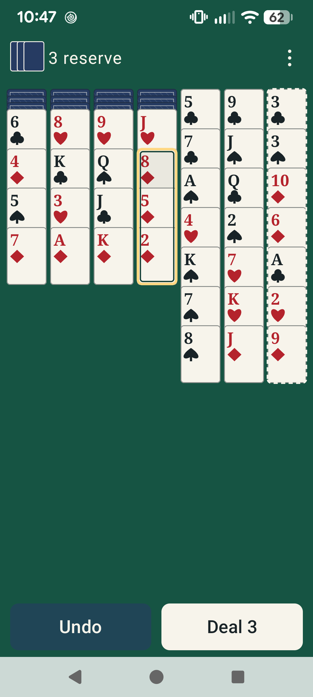

# Phase 4D: approved modern classic interface

Owner explicitly approved the final design in the Work conversation on **2026-11-01**. This authorizes Phase 4D implementation, not merge or publication. Refs [Issue #15](https://github.com/FoxyLight/Wasp-Solitaire/issues/15). The implementation branch starts from main `6c64b6a4899bb3e0fa7790ff1422470608810b83` (merged PR #20, closed Issue #14). The earlier [proposal PR #21](https://github.com/FoxyLight/Wasp-Solitaire/pull/21) is an unmerged historical proposal; its inspection/Hint/title/progress layouts were revised during owner review and are not the approved design.

## Approval record and scope changes

| Decision | Approved final behavior |
| --- | --- |
| 4D-UX-01 | Board-first green table; remove permanent title, tagline and teaching block. Seven columns remain visible across the width; long tails scroll together. |
| 4D-UX-02 | Compact reserve/menu row. Exactly two persistent play controls: Undo and Deal 3. Restart, New Game and Help in Menu; destructive confirmations retained. |
| 4D-UX-03 | **Revised by owner:** remove the separate Inspect screen and button. Readable exposed strips, board scrolling and direct accessibility actions replace inspection. |
| 4D-UX-04 | Tap a face-up card selects that card and its whole attached tail. Tap legal column commits that group. Tap illegal column clears selection only: board, revision and Undo stay unchanged. No separate visible destination chooser or selection toolbar. |
| 4D-UX-05 | Warm ivory faces, original traditional suit artwork, restrained blue backs, continuous gold/dark selected-group outline; legal columns have a dashed edge. Completed suits stay on the board; no top completion display. |
| 4D-UX-06 | Portrait bottom controls, short-window side controls, centered width-capped tablet cards. Large text stacks indices and grows overlap; no height-driven tiny type. |
| 4D-UX-07 | Every exposed source and legal destination available through board accessibility actions, native selected/start/attached-tail semantics and keyboard controls. No second tableau or rule implementation. |
| 4D-UX-08 | High-contrast palette, safe insets, non-color state cues and immediate feedback without required motion. No new preference settings. |

The owner explicitly removed **Hint as a feature**, including reserve suggestions. This supersedes MVP-08 / MVP-DEC-03 and the Hint portions of UX-DEC-05 and MVP-12. The pure engine's existing legal-move/hint APIs and tests remain unchanged to preserve its established contract; the application exposes no Hint intent, state or control. RULE-01–06 and all engine legality remain unchanged.

The owner subsequently requested removal of visible column headings and tighter exposed-card spacing; those details supersede the concept. The image is an AI-generated design illustration, not an application screenshot or imported runtime card pack. It is the owner's accepted visual direction; platform typography, responsive spacing and actual rendered evidence are validated separately. The concept has no title, Hint, Inspect, completion display or extra selection toolbar.

## Owner-requested spacing refinement (2026-11-01)

Visible column numbers and their heading row are removed; column identifiers remain in accessibility descriptions/actions. Each face-up overlap reclaims half the unused space below the rank/suit, preserving the existing rank/suit sizes, system text scaling and whole-card dimensions. The legal-destination dashed border remains. Selected outlines, drag previews and hit bounds share the same geometry. Long columns still scroll.

At 360dp of board space and 130% font, the exposed step decreases from 51.18dp to 47.25dp, saving 3.94dp per face-up overlap in addition to the removed heading row. This is a geometry calculation, not a measured human performance gain.

## Implementation contract

The existing GameController, ViewModel/StateFlow, immutable GameSession and atomic repository contract remain authoritative. Invalid tap destinations are validated by the engine before clearing transient selection; failed writes and stale revisions do not fabricate successful moves. Direct explicit `Select` remains available to accessibility and drag inputs; the visual two-tap path always treats its second card/column tap as a destination, including the source column. Back cancels selection. Whole-tail long-press drag remains supported; no auto-scroll dependency is introduced.

Cards use original Compose suit paths, not the generated image artwork. Width determines card size (maximum 104dp), ranks never shrink below a 14sp base to fit height, and exposed overlap grows for system text scale. All seven columns share a scroll surface. Empty columns remain visible destinations. Large standalone menu/play controls target at least 48dp; narrow overview strips are not falsely described as 48dp targets.

Each column exposes native custom accessibility actions for every exposed card, naming rank/suit and attached count. After selection, legal columns expose an explicit Move action, with Cancel selection also available. Card semantics distinguish selected start from attached cards and never reveal hidden identities. Keyboard: Tab to a column, Up/Down chooses an exposed source, Enter/Space selects or commits to the focused column, Escape cancels. A focus cursor scrolls into view. These are direct board actions, not a replacement Inspect screen. TalkBack listening and Switch Access must be reported only when actually exercised.

Normal selection, illegal-tap cancellation and success feedback have a polite live region without a visible selection toolbar. Storage errors, stale-state notices and victory are readable visible feedback. Confirmations retain existing reset predicates and use explicit Restart / New Game action labels.

## Verified implementation and test results

Application/test code head **`7e2fb38e20ddd85787d6b6e849950a26a8b3bea8`** passed [CI run 41327874017](https://github.com/FoxyLight/Wasp-Solitaire/actions/runs/41327874017):

| Check | Actual result and evidence |
| --- | --- |
| [verify](https://github.com/FoxyLight/Wasp-Solitaire/actions/runs/41327874017/job/124911541213) | Android application/test APKs compiled; downloaded JUnit XML: **41 tests, zero failures/errors/skips** (17 pure engine, 24 application JVM). |
| [emulator](https://github.com/FoxyLight/Wasp-Solitaire/actions/runs/41327874017/job/124911860819) | Android 15 / API 35, x86_64 AVD `test`, system animations disabled: **23 tests, zero failures/errors/skips**, 51.016 seconds in downloaded JUnit XML. |
| Pixel 7a instrumentation | Installed the matched app/test APK pair from that verify artifact. Android 17 / API 37, physical 1080×2400px, density override 460, default font scale 1.3: **OK (23 tests)** in **71.149 seconds**. Actual rotation and recreation included. |
| Owner-assisted TalkBack | On the same Pixel with build `270f09689faa4ec7f8044e062aea1c4832aa0988`, the owner confirmed all four checks worked and announcements were clear: card identity/column/tail count, legal movement, illegal-tap cancellation without movement, and Undo. The agent observed service binding/focus but does not claim to have heard the speaker. Subsequent changes prevent stale cancellation notices and compact visual spacing; labels and action semantics are unchanged. The full custom-action/keyboard suite passed again on the spacing refinement; the owner speech check was not repeated. |

Application APK SHA-256 for the final application/test code head: `952e23e702956cf2c8e9e163124d9775e63f362cfb2b4b26b8e1517980aba67f`. Existing internal app files and previous development APKs were preserved privately before replacing the test installation after Android rejected the different CI debug signing key. No production signing configuration changed. TalkBack settings were restored to their original disabled state after the owner's check; font/density settings were read, not changed.

The final evidence/report commit changes documentation only. Its exact PR head and **both required CI job results on that head** are recorded in [PR #22](https://github.com/FoxyLight/Wasp-Solitaire/pull/22); do not infer a final-head pass from the earlier code-head run above. The workstation has no configured Android SDK, so no local Android build pass is claimed. Builds ran in CI; matched APKs ran on the real device.

### Acceptance coverage

| Behavior | Verification performed |
| --- | --- |
| All legal initial source/destination pairs | JVM tap/drag equivalence over ten seeded deals; physical UI taps and native custom accessibility actions enumerate every engine-legal move in seed 123, checking exact state/history and Undo restoration. |
| Illegal destination / selection cancellation | JVM tests enumerate illegal destinations over 20 seeds; UI checks reject a tapped card without selecting it, clear selected/target semantics, and preserve session/revision/history. Back cancellation included. |
| Whole attached unordered tails / empty columns | Physical taps and long-press dragging move a mixed-order, mixed-suit three-card group; direct accessibility actions move a deep 17-card tail from a 52-card exposed column to an empty column. Identity/order and exact Undo verified. |
| Reserve / no available moves | Reserve remains explicit and available with other legal moves and empty columns; one deal only; Undo restores it. No-moves fixtures retain active status and recovery controls. Hint tests are replaced because the owner removed that feature; pure engine tests remain unchanged. |
| Reset / failures / victory | Restart/New Game confirmation, cancellation and failed writes preserve the session as specified. Completed runs retain all 52 cards; victory allows Undo. No false board/history mutations. |
| Adaptive controls / large text | Same composition/session exercised at **320×640**, **390×780**, **640×320**, **800×1000dp**, plus **320×640**, **700×360** and **640×320dp at 200% text**. Primary/menu targets measured at least 48dp; reserve/Undo and actual legal taps run in each configuration. |
| Lifecycle / resizing | Real MainActivity recreation and requested landscape rotation retain ViewModel/session/selection; Compose configuration overrides exercise window/font transitions. No process-death recovery claim. |
| Accessible input | Native column actions expose all 52 source choices in the crowded fixture; legal destination actions and cancellation preserve engine validation. Selected start/attached count/hidden descriptions asserted. Keyboard Up/Down, Enter and explicit destination commit exercised without dragging. Owner listened to TalkBack as recorded above. |

Visual review found and corrected undersized controls in inset-heavy short windows, selected-state feedback hiding storage errors, a scroll marker covering the last column, and a stale drag-cancellation notice after a successful tap. Tests retain minimum-target and state assertions. The old viewport test tried to scroll an entire width-driven card into a window shorter than that card; it now verifies each exposed rank/suit header is scroll-reachable, with a timeout, while physical move tests still execute every legal seeded move. Screenshot capture uses native viewports; no tests, branch protection, CI gates or engine invariants were weakened.

## Actual screenshot evidence and before/after review

All seven application images below are unmodified native captures from the tested final code head on the Pixel, and were visually inspected. The portrait selected example uses seed 123: **8♦ + 5♦ + 2♦**, legal onto Column 7's **9♦**. The moved image shows that whole group in the destination. The landscape image is an actual rotated Activity (2400×1080px), not a size override. Large-text/tablet captures use Compose configuration overrides on the Pixel; white letterboxing outside the forced app window is the test harness, not wasted application space. CI provides separate emulator captures in its board-rendering-evidence artifact.

| Earlier Phase 4C | Phase 4D actual result | Review finding |
| --- | --- | --- |
| [Crowded top controls/instructions](evidence/phase4c/drag-whole-tail.png) | [Selected tail](evidence/phase4d/selected-tail.png), [committed group](evidence/phase4d/whole-tail-moved.png) | No title/teaching block/Hint/Inspect/progress clutter; complete group boundary and explicit marked target; success has no false cancellation message. Fixtures differ; no task-time or pixel-equivalence claim. |
| [Short landscape](evidence/phase4c/interactive-landscape.png) | [Real Pixel rotation](evidence/phase4d/physical-landscape.png) | Readable width-driven cards, safe right-side controls and scroll margin; lower cards remain scrollable. Different physical/window configurations are labeled, not treated as identical screenshots. |
| [Large text](evidence/phase4c/interactive-large-text.png) | [200% text](evidence/phase4d/interactive-large-text.png) | Rank/suit stack without suppressing system scale; persistent complete play labels; scrolling rather than unreadably small ranks. Capture framing differs (old root capture versus new native viewport). |
| Phase 4C adaptive-board baseline | [Tablet-width override](evidence/phase4d/interactive-tablet.png) | Seven centered columns, readable cards and controls; no inspector pane because owner removed that feature. |
| [Confirmation](evidence/phase4c/restart-confirmation.png), [victory](evidence/phase4c/victory-runs-retained.png) | [Restart](evidence/phase4d/restart-confirmation.png), [victory](evidence/phase4d/victory-runs-retained.png) | Explicit destructive action label, ivory/green modal, completed runs retained and Undo available; no timer/statistics placeholders. |

### Contrast and motion

[Rendered palette and sRGB contrast check](evidence/phase4d/contrast-check.json) from the earlier `dec32f8` build samples actual Pixel pixels (palette/rendering colors are unchanged by the spacing refinement) and verifies the intended fill colors are present. Black/ivory **14.56:1**, red/ivory **5.93:1**, table text/green **8.01:1**, Undo text/blue **10.13:1**, disabled Undo text/rendered background **9.33:1**, selected dark inner boundary/ivory **11.15:1**. Gold/ivory alone is **1.25:1** and is supplementary to the dark edge, shape and native selected semantics. This is fill-pair validation and visual review, not a blanket accessibility certification. Native Material feedback remains system-aware; no custom transition requires motion, and the full CI suite runs with system animations disabled.

## Remaining usability limits

- Very long columns and 200% short windows require scrolling; a whole card may be taller than the usable viewport. Rank/suit headers and direct source/destination actions remain reachable. There is no expanded inspection screen or drag edge auto-scroll, by approved scope; dragging is never the only legal route.
- Column action lists can be long for a heavily crowded column. The 52-source fixture verifies completeness, not that a long native action list is effortless for every screen-reader user.
- Keyboard and TalkBack were exercised as described. A dedicated physical Switch Access device was not available, and is not certified by the custom-action tests. Testing did not separately exercise a real foldable hinge, split-screen keyboard/IME, every navigation mode or every OEM window manager. Configuration overrides are not additional physical devices.
- The report does not claim measured speed gains, a completed human game from start to victory, broad user-study acceptance or store/release readiness. Accepted engine win fixtures and Undo were actually executed.

## Scope boundaries

Session and Undo remain in memory; process termination still loses the game. Room saves, process-death recovery, DataStore, timer/statistics, variants/solvers, accounts/sync/monetization, production signing and publication are deferred. No branch protection, required CI or game-rule relaxation is permitted. Keep the implementation PR open for separate owner merge approval; close Issue #15 only after accepted implementation is merged.
